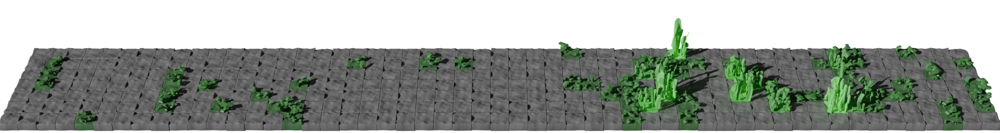

# Hi, I'm Yunseok Lee

I build software that makes AI run well on real hardware, with a focus on optimization and automation. Next, I'm taking this toward robotics and physical AI.

- AI undergrad at Chungnam National University (double major in Convergence Computing), graduating Feb 2028
- AI Intern at Artfly (Jun 2026 - Aug 2026), built VIVA, a voice AI math tutor with a Raspberry Pi robot head
- Open to AI software, robotics, and physical AI roles · Daejeon, Korea
- [dbstjr3576@gmail.com](mailto:dbstjr3576@gmail.com) · [LinkedIn](https://www.linkedin.com/in/yunseok-lee-071890369/)

---

## Tech Stack

---

